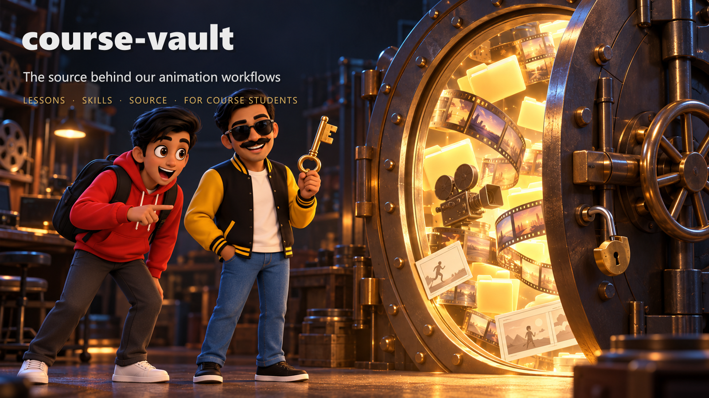
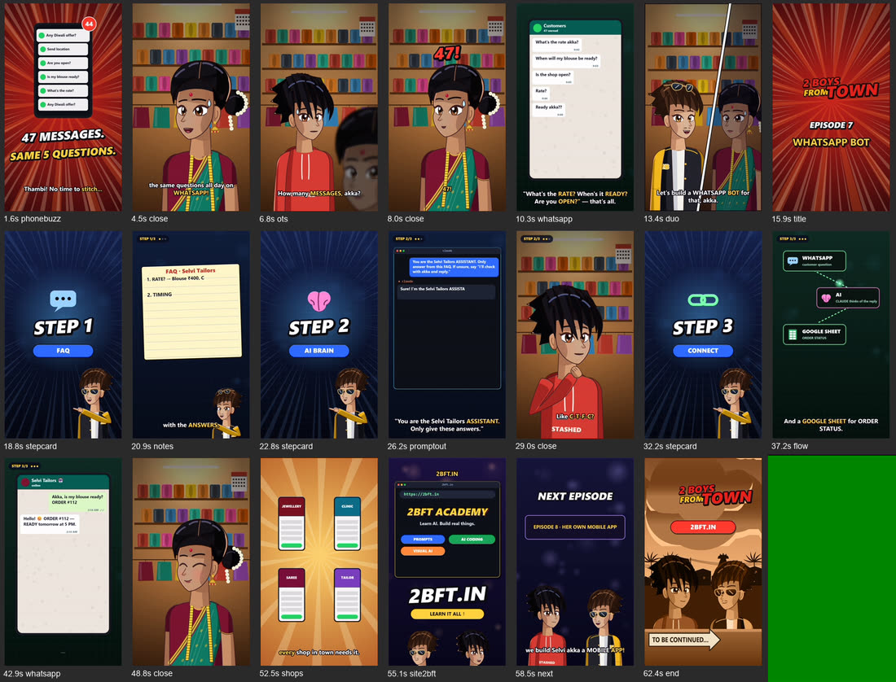
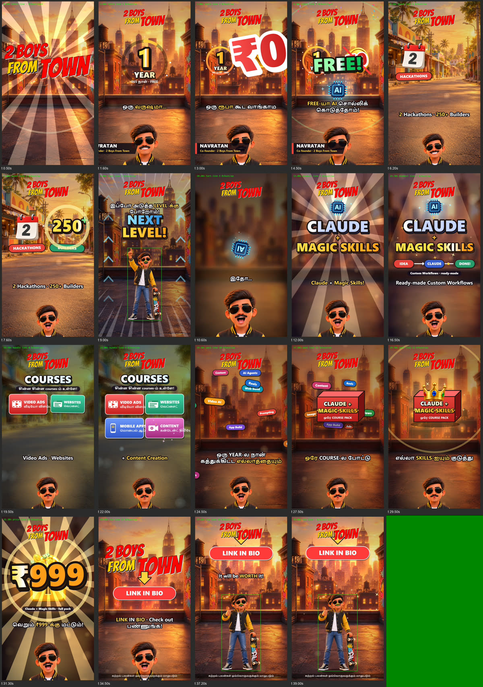
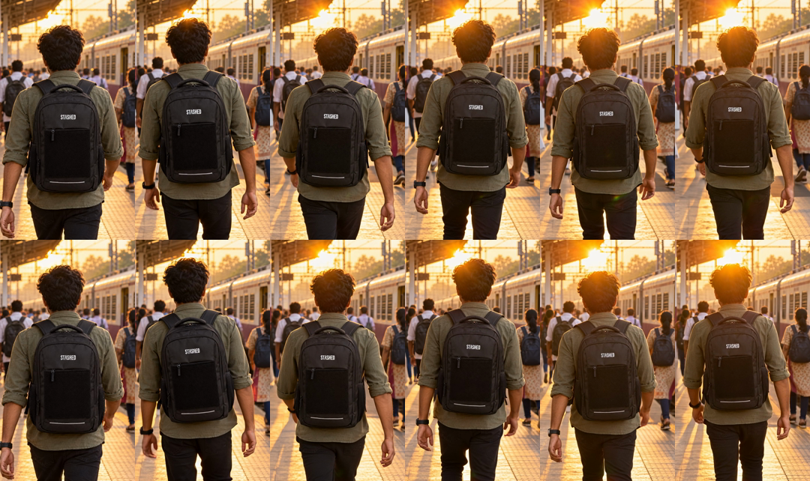
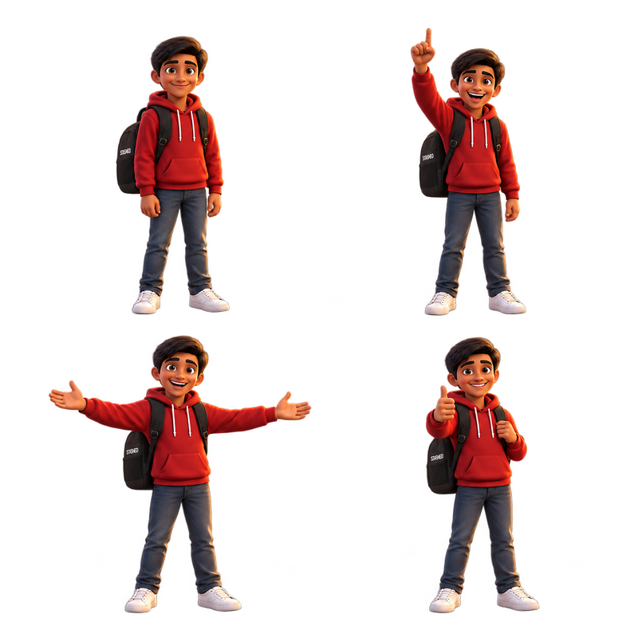
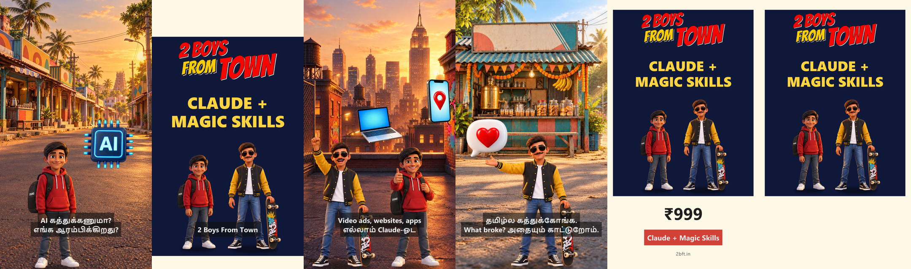

# course-vault

**The full source, lessons and failure logs behind the way we make AI animation and video at 2BFT.** This page is the public index and proof. The files themselves live in a private repo that students of the **Claude + Magic Skills** course get access to.

This is not a pack of finished videos to resell. It is how the work is actually done — the project files, the Claude Code skills, the prompts that worked, and the long list of things that broke — so you can make your own.

👉 **Get access with the course at [2bft.in](https://2bft.in).** Buyers are invited to the private repo (read-only) after purchase.

---

## See what's inside — real outputs

Every image below was produced by the workflow it sits next to, on our own Windows PC with an NVIDIA GPU. The **source files, prompts and Claude Code skills that make them are in the private vault** 🔒 — unlocked with the course.

| Output | Made with |
|---|---|
|  | **Module 02 · Anime in code** — a voiced, lip-synced 1080×1920 episode drawn entirely in code (no AI images), dubbed across languages. 🔒 |
|  | **Module 03 · 3D character films** — Codex characters cut into sprites, given a local voice, and made to talk in a vertical film rendered on the GPU. 🔒 |
|  | **Module 04 · AI video on your GPU** — Codex draws the first frame, WAN 2.2 makes it move, locally, with no per-clip fee. 🔒 |
|  | **Module 06 · The Prompt Vault** — the exact Codex jobs that turn a reference into a usable character sheet, with the lines to change. 🔒 |
|  | **Module 07 · Ad in a Day** — one product photo and five lines become a finished, loudness-checked ad, voiced locally, cut to 9:16 and 1:1. 🔒 |

*(Module 01 · Your own voice — offline Tamil/Hindi/English voice cloning — scored 0.93–0.94 against our real voice. It's audio, so you hear it inside the vault.)*

---

## What's inside

Everything runs on your own Windows PC with an NVIDIA GPU. Where a voice is needed, the lessons use open models that run locally (Chatterbox for English, AI4Bharat IndicF5 for Tamil and Hindi); paid APIs appear only as optional examples.

| # | Module | What you learn to make |
|---|---|---|
| 01 | **Your own voice, offline** | Record ~4 minutes of yourself, then speak any script in Tamil, Hindi or English in your own cloned voice, on your own GPU. |
| 02 | **Anime in code** | A ten-step guided build from a blank script to a voiced, lip-synced, scored 1080×1920 Reel, drawn entirely in code, then dubbed. |
| 03 | **3D character films** | Draw a character with Codex, cut it into sprites, give it a local voice, and make it talk in a vertical film that renders on your GPU. |
| 04 | **AI video on your GPU** | Codex draws the first frame, WAN 2.2 makes it move — locally, no per-clip fee. Includes the real ~37 GB cost and the full failure log. |
| 06 | **The Prompt Vault** | 28 image and video prompts that produced usable results, each with proof and the exact lines to change. |
| 07 | **Ad in a Day** | One product photo and five lines → a finished Tamil (or any-language) ad, voiced locally, loudness-checked, 9:16 and 1:1. |

Every module ships a `README.md` guided lesson, a `LESSONS.md` of what broke and how we fixed it, the working `src/`, Claude Code `skills/`, and short `examples/` so you can check your result matches ours.

---

## This builds on our free, open tools

The free MIT repos below give you the engines. The vault teaches the order of work, the decisions, and the failures, and gives you the deeper project files.

[indic-voice-clone](https://github.com/2boysfromtown/indic-voice-clone) · [photo-to-tamil-ad](https://github.com/2boysfromtown/photo-to-tamil-ad) · [hyperframes-motion](https://github.com/2boysfromtown/hyperframes-motion) · [thinking-radio](https://github.com/2boysfromtown/thinking-radio)

---

## FAQ

**Do I get finished videos?** No. You get the workflows, source and templates to make your own. That is the point.

**Can I use what I make commercially?** Yes, your own output is yours. You may not re-share, resell or re-upload the vault itself.

**What do I need?** A Windows PC with an NVIDIA GPU (we use an RTX 5070 Ti, 16 GB). Each module lists exactly what it was tested on.

**How do I get in?** Buy the course at [2bft.in](https://2bft.in). After purchase you give your GitHub username and we invite you to the private repo.

---

Built by **[2BFT, Two Boys From Town](https://2bft.in)** — a free AI school from Vaniyambadi, Tamil Nadu. Follow [@navaratan.ai](https://instagram.com/navaratan.ai).
